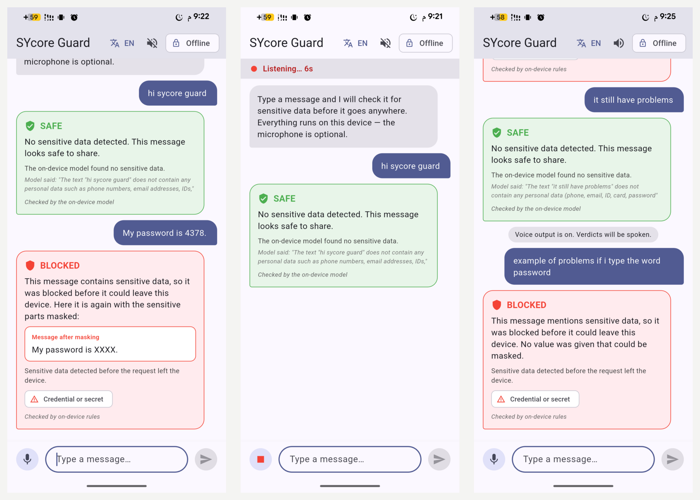
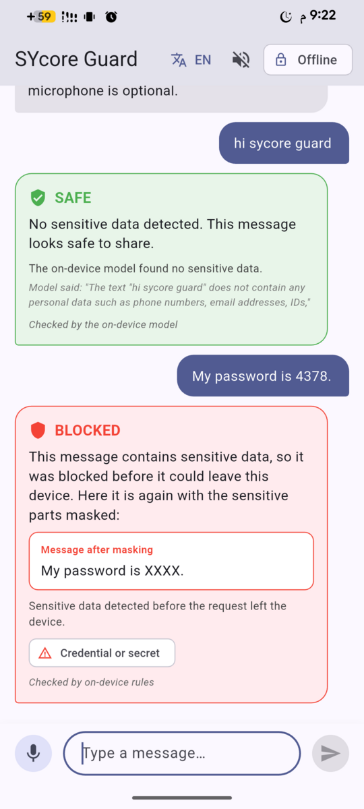
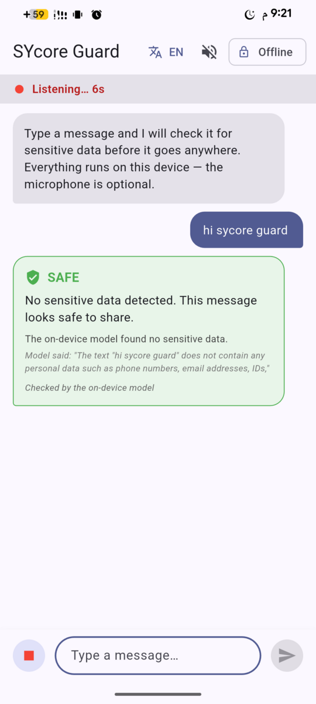
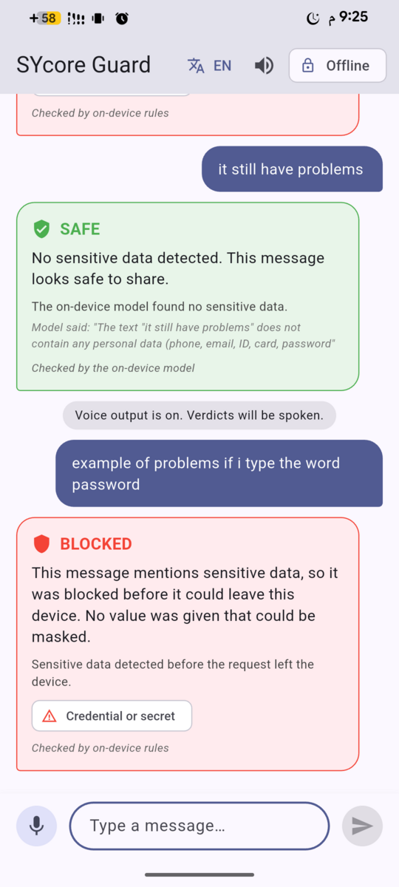
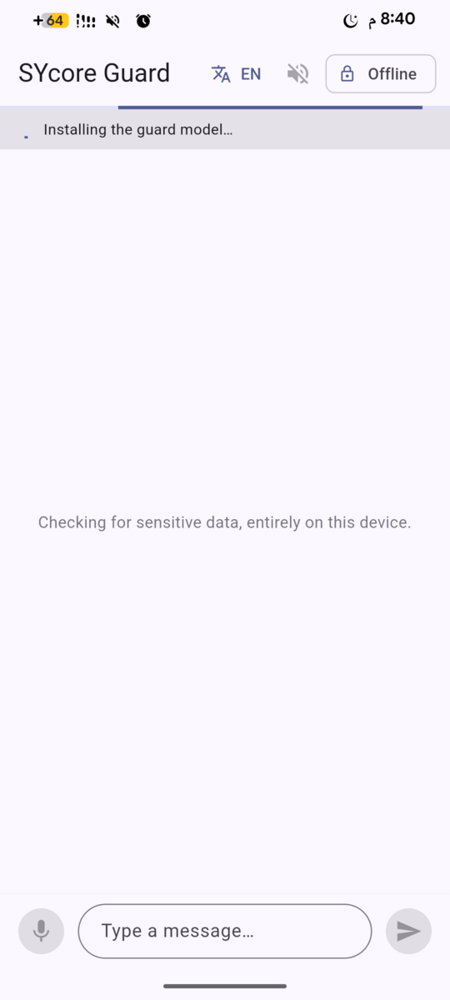

# SYcore Guard

**An offline privacy guard for text and voice.** Type a message — or speak it — and the app
tells you whether it carries sensitive data, blocks it, and shows you the same message with
the secrets masked out.

Classification, speech-to-text and text-to-speech all run **on the device**. No audio,
transcript or verdict leaves the phone.

[](https://github.com/NasreddineLoukriz/sycore_guard/actions/workflows/ci.yml)




---

## What it does

```
text ─┬──────────────────────────────────┐
      │                                  ▼
voice ┴─→ Whisper-tiny (optional) ─→ rules ─→ Qwen3-0.6B ─→ verdict (optionally spoken)
        on device, 30 s window        µs       on device        Matcha-TTS, 22 kHz
```

- **Chat-first.** A normal message list. Typing is the main path and never touches the
  microphone, the STT model or the TTS model.
- **Voice in.** Up to 30 seconds, transcribed locally by Whisper-tiny and dropped into the
  composer for review — never sent on the mic's word alone.
- **Verdict out.** Optional speech, synthesised by Matcha-TTS. The two fixed verdict phrases
  are cached as WAV after a one-time preparation, so they replay instantly.
- **Bilingual.** Arabic and English UI, and Arabic-Indic/Persian digits (`٠٦٦٣١٢٣٣`) are
  recognised as digits by the masking rules.

## See it work

| Leak caught and masked | Voice, transcribed locally | Spoken verdict | First run installs the model |
|---|---|---|---|
|  |  |  |  |

The masked copy in the first screenshot is what the user gets back: each detected value is
replaced by a run of `X`s of the same length, and the words around it stay readable, so the
message can still be reused without the secret.

## How the decision is made

The verdict is **fail-closed**: anything undecided is a block.

1. **Rules first.** Phone numbers, emails, Luhn-valid card numbers, IBANs, SSN-shaped IDs and
   credential keywords (English + Arabic) block immediately, without waking the model. The
   common dangerous cases cost microseconds.
2. **Then the on-device LLM.** One plain question — *does this text contain personal data?* —
   followed by the message. No system prompt and no `SAFE`/`BLOCKED` answer labels: measured
   on the shipped model, both made it block benign text such as "hello".
3. **Lenient parsing, strict outcome.** "does not contain personal data" clears the message;
   a stated block always wins; an empty reply, a refusal, a timeout or an exception resolves
   to **BLOCKED**.
4. **The transcript cannot become a prompt.** It is flattened onto a single `Text:` line and
   capped at 1,200 characters.
5. **Failures are named, not disguised.** A model failure is reported as a verification
   failure — retried once on a rebuilt session — instead of silently reading as "sensitive".
6. **Secrets are never echoed.** Findings chips show matched values masked.

## Performance notes

| Optimisation | Effect |
|---|---|
| Text-first flow | No recording, STT load or WAV parsing for typed messages |
| Rules before model | Obvious leaks resolve in microseconds |
| 1,024-token context, 24-token cap | Smallest context the `.litertlm` allows; the cap only bounds a rambling model |
| Early stop on the verdict | Decoding stops at `BLOCKED`/`UNSAFE`, or a short `SAFE` |
| No system prompt, no answer labels | Removes a measured false-block mode |
| One reused session, cleared per check | No per-message graph/KV initialisation |
| Startup warm-up | The first real message does not pay init cost |
| NPU → GPU → CPU preference | Fastest backend the device supports |
| Lazy install/load | First launch copies 329 MB instead of 460 MB; STT/TTS load on demand |

The 0.6B classifier answers in well under a second on a phone CPU; the rules path is
effectively free. No benchmark is claimed against a cloud classifier — the point of this app
is that the message never leaves the device.

## Requirements

| Platform | Status |
|---|---|
| Android | Primary target. `minSdk 30`, `arm64-v8a` only. Debug APK built and run on a device. |
| iOS / macOS | Supported by the runtime; microphone usage strings are configured, not exercised. |
| Linux / Windows | Runtime supports the engines; not exercised by this demo. |
| Web | No STT/TTS, so voice controls are hidden; text checks still work. |

## Run it

The weights (~460 MB) are **not** in the repository. Fetch them once:

```bash
# see docs/models.md for the full list, checksums and licences
curl -L -o assets/models/llm/Qwen3-0.6B_dynamic_wi4b32_afp32.litertlm \
  "https://huggingface.co/litert-community/Qwen3-0.6B/resolve/main/Qwen3-0.6B_dynamic_wi4b32_afp32.litertlm"
# … plus Whisper-tiny (int8 + tokenizer) and the Matcha bundle
```

Then:

```bash
flutter pub get
flutter run -d <device>          # 64-bit ARM Android device/emulator, API 30+
```

First launch copies the guard model into app storage with a progress strip; it is idempotent
afterwards. `docs/models.md` lists every file, its size and its SHA-256 prefix.

## Testing

```bash
flutter analyze   # clean
flutter test      # 56 tests + 1 asset check that skips when the weights are absent
```

Coverage: rules and Luhn, masking (including Arabic-Indic digits), the verdict parser and its
fail-closed paths, the guard pipeline with a fake model, WAV chunk parsing, message bubbles,
language catalogue and asset declarations. GitHub Actions runs the same two commands on every
push (`.github/workflows/ci.yml`).

## Project layout

```
lib/
├── main.dart                       # engine registration + error-screen fallback
└── src/
    ├── audio/
    │   ├── speech_languages.dart   # STT language catalogue for the picker
    │   ├── wav_codec.dart          # WAV chunk parsing + PCM → WAV container
    │   └── voice_output.dart       # optional TTS with cached verdict phrases
    ├── chat/chat_message.dart      # chat entry model (pure Dart)
    ├── guard/
    │   ├── guard_logic.dart        # rules, Luhn, masking, fail-closed parser (pure Dart)
    │   └── guard_service.dart      # rules + LLM orchestration, prompt hardening
    ├── models/model_installer.dart # on-demand installs with progress
    └── ui/
        ├── chat_screen.dart        # chat UI, optional mic, optional speaker
        ├── message_bubble.dart     # bubbles/verdict rendering (widget-testable)
        └── startup_error_screen.dart
```

## Honest limits

- **Not an audited security product.** It is a working prototype: no independent review, no
  threat model sign-off, no penetration test.
- **Keyword + small-model heuristic.** A 0.6B model catches paraphrases a regex misses, and
  still misses cases a bigger model would catch. Conservative by design: a credential
  keyword blocks even when no value follows.
- **The verdict voice is English only.** Matcha is an English voice; the STT language is
  selectable and remembered.
- **`INTERNET` is in the merged manifest**, pulled transitively by the model-download
  plugin that `flutter_edge_ai` depends on. The app reads bundled assets only and issues no
  request; the permission can be removed with a `tools:node="remove"` manifest rule for a
  network-free build.
- **Release signing is still the debug config** in `android/app/build.gradle.kts`. Replace the
  keystore before publishing anywhere.
- **A shipping build must not carry the weights in the base module** (Play's 200 MB limit).
  Use Play Asset Delivery or download-on-first-use.

## Licence

MIT for the code (`LICENSE`). Model weights keep their upstream licences — see
`docs/models.md`.

---

### بالعربية

**SYcore Guard** تطبيق يحمي ما تكتبه أو تقوله قبل أن يخرج من هاتفك: يكتشف أرقام الهواتف
والبطاقات وكلمات المرور، يمنع الرسالة، ويعيدها إليك وقد حُجبت القيم الحسّاسة فيها. التصنيف
والتعرّف على الكلام والتوليد الصوتي تعمل كلها **داخل الجهاز** دون أي اتصال بالشبكة. الكود
مفتوح (MIT)، والأوزان تُحمَّل محليًا حسب `docs/models.md`.
